# Trading Empire

**Trade the market. Build a city.**

Trading Empire is a game in two halves. In the **trading terminal** you trade real historical forex and gold prices by hand, one candle at a time. In the **city** you spend your trading profit on buildings that pay rent, so a good trader grows a bigger city, and the city's mood follows how well you trade.

This is the Unity version (Unity 6, `6000.2.13f1`). It is a full port of the browser game, and it opens the web game's save files and the other way round.

[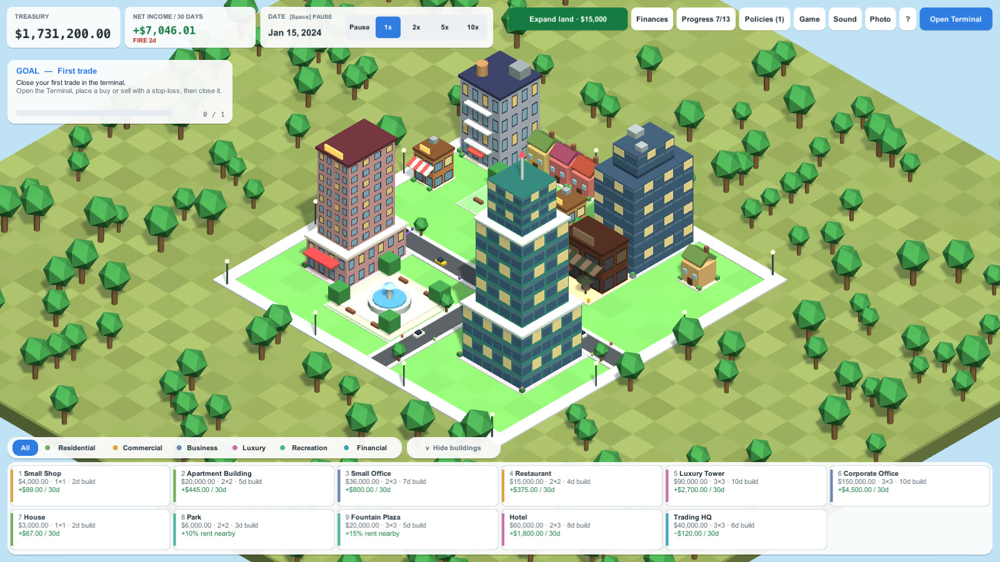](docs/trailer/Trading-Empire-Unity-trailer.mp4)

> **Trailer:** [watch the 70 second trailer](docs/trailer/Trading-Empire-Unity-trailer.mp4) (MP4, recorded from the real game).

## Contents
1. [How the game works](#how-the-game-works)
2. [The trading terminal](#the-trading-terminal)
3. [Adding your own market data](#adding-your-own-market-data)
4. [The trade journal](#the-trade-journal)
5. [The city](#the-city)
6. [Trading shapes the city](#trading-shapes-the-city)
7. [Missions, challenges and progress](#missions-challenges-and-progress)
8. [Saves, settings and tools](#saves-settings-and-tools)
9. [All the keys](#all-the-keys)
10. [Run it, build it, test it](#run-it-build-it-test-it)
11. [For developers](#for-developers)

---

## How the game works

1. You start in the **city** with an empty treasury and a **trading account** of **$10,000**.
2. Open the **Terminal**. Time only moves when you press Play or step a candle. Plan a trade, place it, and let the market play until your stop-loss or take-profit is hit (or close it yourself).
3. **Only realised profit counts.** Use **Transfer funds** (in the terminal, or **Finances** in the city) to move closed-trade profit from the trading account into the **city treasury**. Open profit and margin in use cannot be moved.
4. Spend the treasury on **buildings**. They take a few days to finish, then pay rent every 30 days and cost upkeep.
5. Reinvest, complete **missions** to unlock bigger buildings and more land, and watch how your **trading record** changes the city: a hot streak starts a boom, a cold one a panic.
6. Careful: if the trading account **and** the city treasury both run empty and no building earns income, it is **game over**. (Your saved game is not touched, you can load it.)

The first time you open the game a welcome dialog explains this, and a **guided first trade** walks you through your first position with a yellow frame around the button to use at each step.

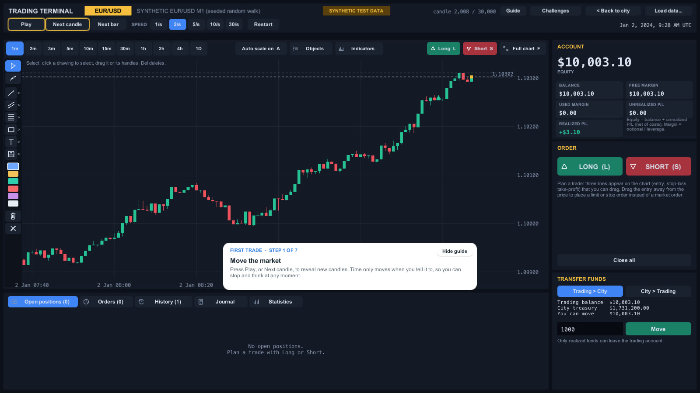

---

## The trading terminal

The terminal replays historical candles. It never shows a candle you have not revealed yet: **no looking ahead**, anywhere (chart, indicators, journal chart).

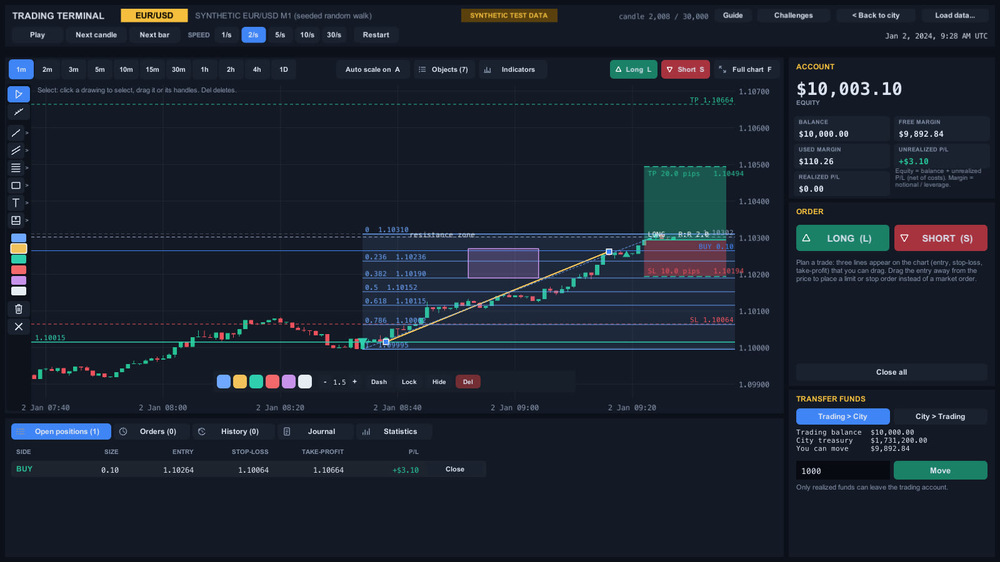

### Moving the market
- **Play / Pause** (Space), **Next candle** (Right arrow) and **Next bar** (Shift + Right arrow, one bar of the chart timeframe).
- **Speed**: 1, 2, 5, 10 or 30 candles per second. **Restart** starts the data again from the beginning (open positions are closed at market first).
- **Timeframes** above the chart: the data's own timeframe and every whole multiple of it (for M1 data: 1m, 2m, 3m, 5m, 10m, 15m, 30m, 1h, 2h, 4h, 1D). The newest bar builds up candle by candle.

### Planning and placing a trade
Press **Long** (L) or **Short** (S). Three lines appear on the chart that you can **drag**: the **entry**, a red **stop-loss** and a green **take-profit**. The order panel shows the same plan, and either one can be edited.

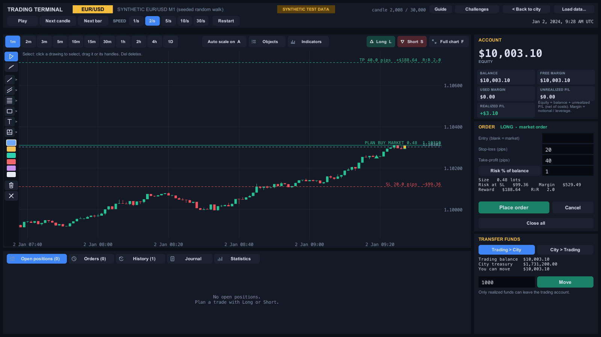

- **Market, limit or stop:** leave the entry on the price for a market order. Drag the entry away from the price to place a **limit** or **stop** order that waits until the market reaches it. Close to the price it snaps back to a market order.
- **Size by risk or by lots:** *Risk %* (default 1% of your balance) works out the lot size from your stop-loss. *Fixed lots* uses the size you type.
- **Live preview:** lots, **risk at the stop-loss**, reward at the target, **reward : risk** and the margin it needs. If an order cannot be placed (stop on the wrong side, not enough margin, size out of range) the panel says why.
- **Place order** (or Enter). **Cancel** (or Esc) drops the plan. In **Full chart** mode a small bar at the bottom shows the plan and the same buttons.

**The rules of the market** (the same as the web game):
- Buys fill at the **ask**, sells at the **bid**; the spread is real. A commission is charged per round trip.
- Leverage is **1:100**. A position is stopped out if the margin level falls to 50%.
- If one candle touches both your stop-loss and your take-profit, the **stop-loss counts first**.
- A resting order that a candle gaps through fills at the open (better for limits, worse for stops).

### The chart
- **Candles, a grid, price and time axes**, your open trade lines, pending orders, and buy / sell markers.
- **Mouse wheel** zooms the chart. **Drag the chart** to scroll back through time; with **Auto scale off** it also moves up and down. **Drag the price axis**, or hold **Shift** or **Ctrl** and use the wheel, to scale prices. **End** jumps back to the newest candle.
- **Auto scale on/off** (A), **Full chart** (F) and **Measure** (M: click two points to see pips, price difference, bars, time and percent).

### Drawing tools (21 kinds)
A palette on the left of the chart: cursor, measure, and six groups. Each shows the last tool you used, and the small `>` opens the whole group.

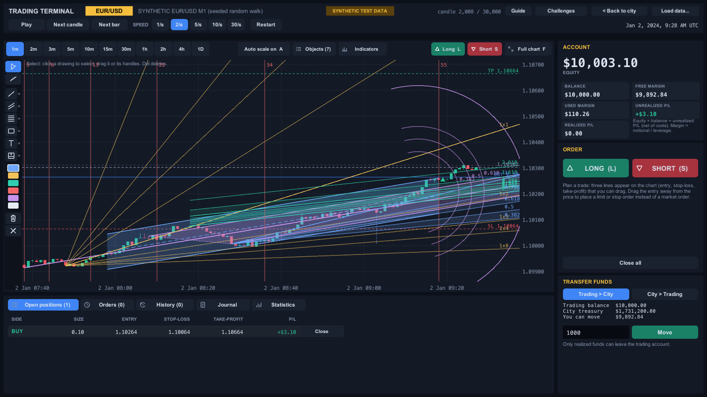

| Group | Tools |
| --- | --- |
| Lines | Trend line, Ray, Extended line, Arrow, Horizontal line, Horizontal ray, Vertical line |
| Channels and fans | Parallel channel, Regression channel, Andrews' pitchfork, Gann fan |
| Fibonacci | Retracement, Extension, Channel, Time zones, Speed fan, Arcs |
| Shapes | Rectangle, Ellipse, Triangle |
| Notes and marks | Text note, Price label, Arrow up, Arrow down |
| Trade planning | Long position box, Short position box (entry, stop and target with money at risk and R:R; **Use in the order panel** turns one into a trade plan) |

Click a drawing to select it: drag it, drag its handles, change its **colour, width, dashes**, **lock**, **hide** or **delete** it. Colour swatches, a trash and a clear-all button sit in the palette. Drawings are saved with the game, per dataset.

**Fibonacci levels are editable.** Select any Fibonacci drawing and the **Levels** panel opens:

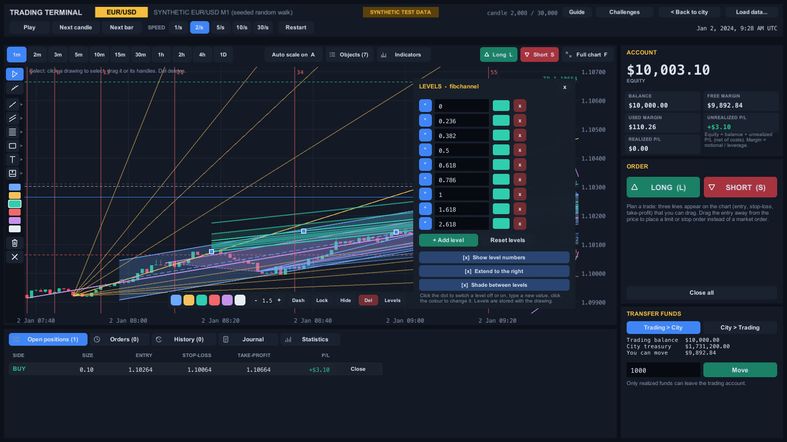

- change the **number** of any level (type `0.705`), switch a level **off or on** with its dot, give a level its **own colour**;
- **+ Add level** adds a new one, the red **x** deletes one, **Reset levels** brings back the defaults;
- options: show level numbers, show prices, extend to the right, shade between levels.

### The object list
**Objects** lists every drawing: select, **rename** (`ab`), show or hide, lock, move up or down in the stack, delete, hide all, delete all.

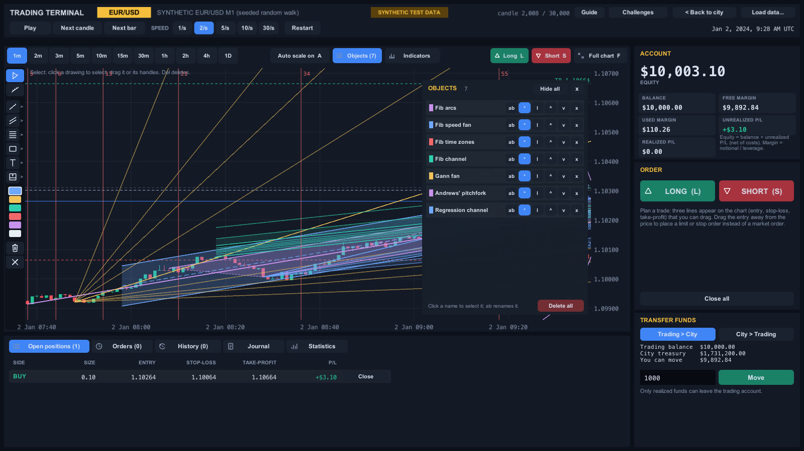

### Indicators (16)
**Indicators** adds technical indicators. They only ever use candles you have already seen.

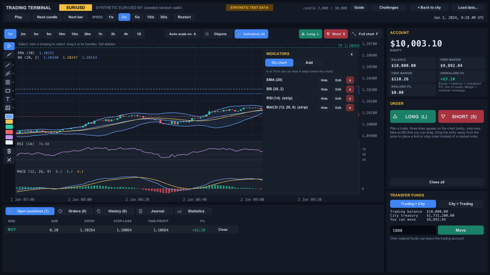

- **On the chart:** simple, exponential and weighted moving averages, Bollinger Bands, Donchian channels, Keltner channels, Parabolic SAR.
- **In strips below:** RSI, MACD, Stochastic, ATR, CCI, Williams %R, ROC, ADX, Volume (up to four strips).
- For each one: **hide**, edit the **settings** (periods, deviations...), change the **colour** of every line, set the **line width**, or remove it. They are saved with the game.

### Account, orders, history, statistics
The right side shows the **account** (equity, balance, free margin, used margin, unrealised and realised profit), the **order** panel and the **transfer** card. Below the chart:

- **Open positions:** side, size, entry, stop-loss, take-profit, live profit and loss, and a **Close** button. Drag a position's stop or target line on the chart to change it.
- **Orders:** resting limit and stop orders.
- **History:** every closed trade, how it closed (manual, stop-loss, take-profit, stop-out) and its net result.
- **Statistics:** trades, wins, losses, win rate, net, gross profit and loss, average win and loss, profit factor, average R and maximum drawdown.

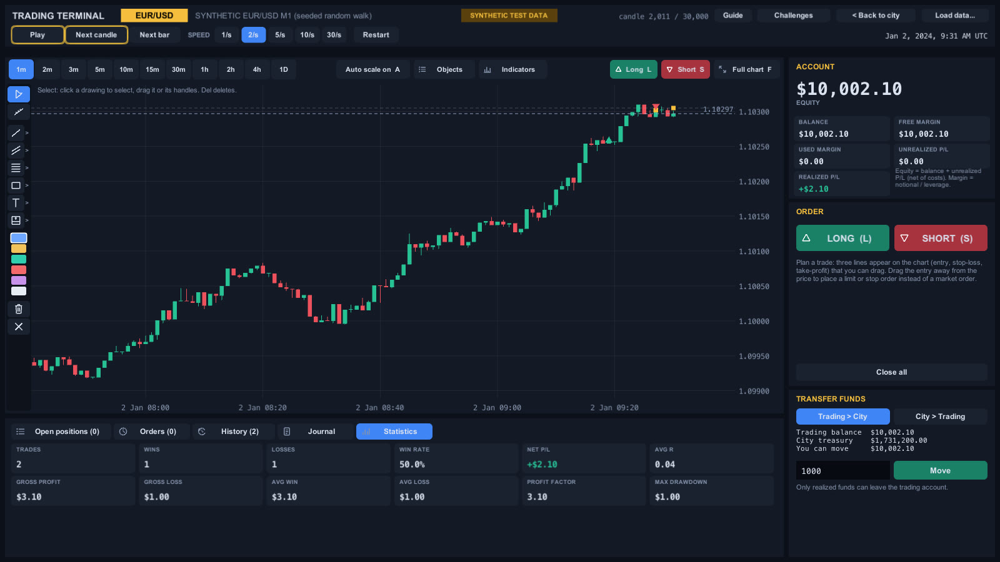

### Moving money to the city
The **Transfer funds** card moves money **Trading > City** or **City > Trading** (type an amount, press Move). Only realised funds can leave the trading account.

### Built-in guide
**Guide** in the top bar opens four tabs: how to open a position, the drawing tools, **how to load MT4 / MT5 data**, and every shortcut.

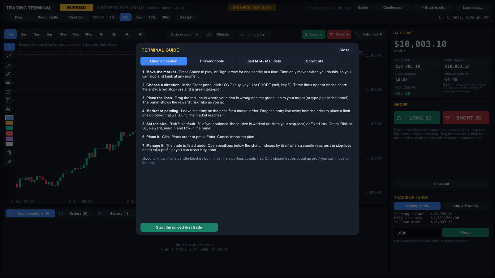

---

## Adding your own market data

The terminal starts on **labelled synthetic test data** (a seeded random walk, never presented as real prices). To trade real history, load a file.

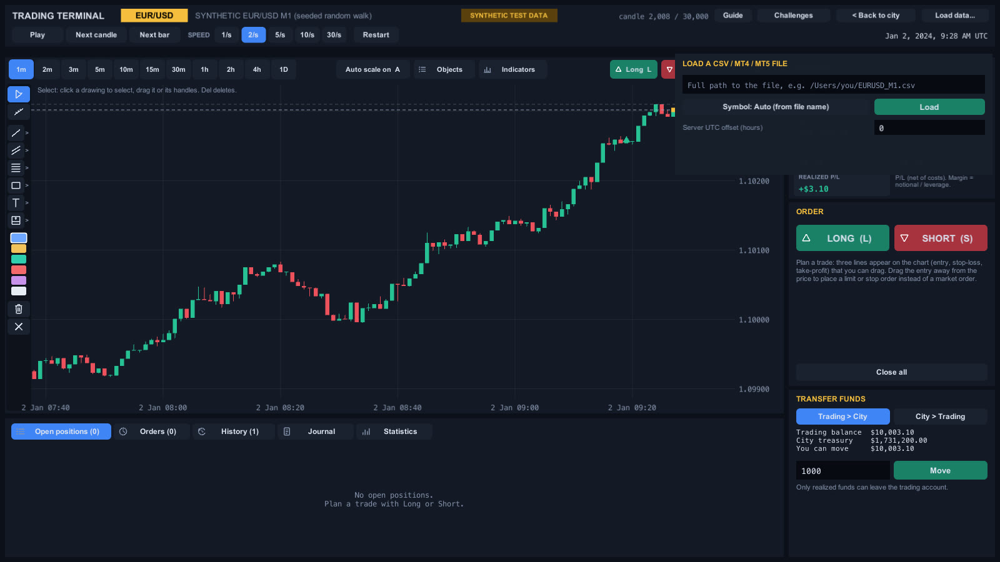

### 1. Export history from MetaTrader

**MetaTrader 5**
1. **View > Symbols** (Ctrl+U), open the **Bars** tab.
2. Pick the symbol (for example `EURUSD`), a timeframe and a date range, then click **Request** so MT5 downloads the history.
3. Click **Export Bars** and save the `.csv`. It is tab separated, has a header row (`<DATE> <TIME> <OPEN> ...`) and includes a spread column, which the game uses.

**MetaTrader 4**
1. **Tools > History Center** (F2).
2. Open the symbol and a timeframe (click **Download** first if it is empty or short).
3. Click **Export** and save the `.csv`. MT4 files have no header row and no spread, so the game uses a fixed spread for the symbol.

**A plain CSV** also works: columns `timestamp,open,high,low,close` (optionally `volume` and `spread`), ISO 8601 timestamps, UTC by default. A small example is in [`docs/sample-data/EURUSD_M15_synthetic_example.csv`](docs/sample-data/EURUSD_M15_synthetic_example.csv) (synthetic prices, about two weeks of 15 minute candles, only to show the format).

### 2. Load it in the game
1. Open the **Terminal**, click **Load data...** at the top right.
2. Type the **full path** of the file, for example `/Users/you/EURUSD_M1.csv`.
3. **Symbol:** left on *Auto*, the symbol is read from the file name (MetaTrader names exports like `EURUSD_M1_...csv`). If the name does not say, click the Symbol button to choose one.
4. **Server UTC offset (hours):** MetaTrader files use your broker's clock, often UTC+2 in winter and UTC+3 in summer. Type the number of hours your broker is ahead of UTC (for example `2`) to get true UTC times. If you do not care about the exact clock, leave it at `0`.
5. Click **Load**.

What happens: open positions are closed at market, the replay starts at the beginning of the file, the chart offers the file's timeframe and every whole multiple of it, and the dataset is **saved inside your game save**, so loading the game brings the same data back.

### What is accepted
- **Symbols:** EUR/USD, GBP/USD, AUD/USD, NZD/USD, USD/JPY, USD/CHF, USD/CAD and gold (XAU/USD). Each has its own decimals, pip size, spread and lot rules. Pairs without USD (such as EUR/GBP) are not supported.
- **Timeframe:** export **M1** for the most freedom (you can build any longer timeframe from it, never a shorter one). M15 gives a smaller file.
- **Bad rows are never guessed.** Rows with impossible prices (high below low and so on) are skipped and counted, and the first line numbers are listed. Duplicates are dropped, unsorted files are sorted, and the report says what happened.
- **Wrong symbol?** If the prices do not look like the chosen symbol (for example gold prices loaded as EUR/USD) the file is **refused** with a message, not loaded with wrong numbers.

---

## The trade journal

Reviewing trades is how traders improve, so every closed trade can be written up.

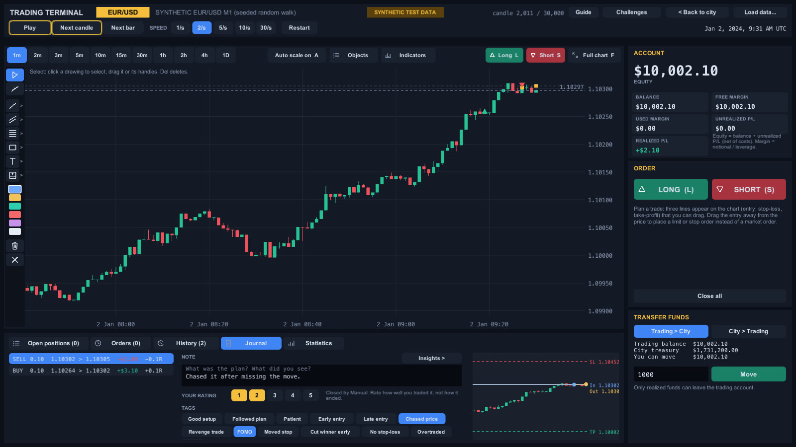

Open **Journal** below the chart. The list shows your most recent closed trades (side, size, entry and exit, result, R). Select one to see:

- a small **chart of that trade**: the candles around it, the **entry** and **exit** markers joined by a line, and the **stop-loss**, **take-profit**, entry and exit prices;
- a **note** (what was the plan, what did you see);
- a **rating** from 1 to 5: *how well you traded it, not how it ended*;
- **tags** you can switch on: Good setup, Followed plan, Patient, Early entry, Late entry, Chased price, Revenge trade, FOMO, Moved stop, Cut winner early, No stop-loss, Overtraded, News.

**Insights** (button at the top right of the journal) shows which habits earn or lose money: results **by session**, **by tag**, and your **best hour (UTC)**. It needs a few tagged trades to say anything useful.

Journal entries are saved with the game and open in the web version.

---

## The city

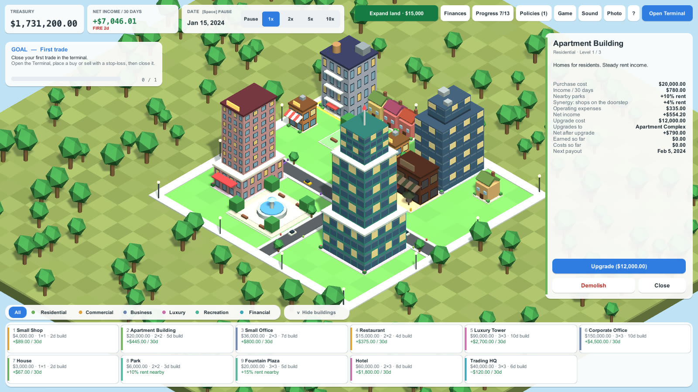

You build on a grid with streets. The **build dock** at the bottom has a card for every building with its **cost, size, build time and what it earns**, or **why it is locked** and which mission unlocks it. Filter by district tab. Press **1 to 9** to pick a building, click the map to place it (**R** rotates, **Esc** or a **right click** lets go of it).

| Building | District | Notes |
| --- | --- | --- |
| House, Apartment Building | Residential | steady rent |
| Small Shop, Restaurant | Commercial | mid-sized income |
| Small Office, Corporate Office | Business | high income, high running costs |
| Luxury Tower, Hotel | Luxury | the best rents, income grows with upgrades |
| Park, Fountain Plaza | Recreation | earn nothing, but raise the rent of buildings near them |
| Trading HQ | Financial | a landmark whose level follows your closed trades |

- **Under construction** buildings show scaffolding and a progress bar, then bounce when finished.
- **Click a building** for its card: purchase cost, income per 30 days, every bonus and penalty (parks, synergies, market mood, policies, events), operating expenses, **net income**, **upgrade cost and what it upgrades to**, earned and spent so far, and the next payout date. **Upgrade** or **Demolish** (it asks twice and shows the refund).
- **Synergies:** neighbours help each other. Office workers lift restaurants, residents lift shops, hotel guests lift restaurants, shops lift apartments, all within three cells; park bonuses and synergies are capped together.
- **Land:** you start on a small plot. **Expand land** (top bar) buys the next district (Riverside, Midtown, Uptown) once its mission is done.
- **Floating numbers** show each building's rent when it pays out. Streets have traffic and pedestrians, and there are trees, lamps and a sun with soft shadows.
- **Finances** shows cash, income and expenses for the last 30 days and all time, income by building, and recent transactions.

**Photo mode** (the Photo button) hides the interface. Save a **screenshot** (to `Pictures/Trading Empire`) or start a slow **fly-over** of your city. Esc leaves.

---

## Trading shapes the city

**Market mood.** The city looks at your last 10 closed trades (at least 5). A **win rate of 60% or more with a net profit** starts a **boom**: +3% rent on every building. A **win rate of 30% or less with a net loss** starts a **panic**: +8% upkeep. A chip in the top bar shows it.

**Events.** Now and then the city has a **fire** (one building closes for 10 days and earns no rent; the repair costs 12% of its price), a **storm** (6 days, rent falls by 20%) or a **festival** (8 days, rent rises by 20%). Chips show how many days are left, and the effect is in each building's card.

**Policies.** Switch policies on or off for free: **Marketing push** (more rent for shops, restaurants and hotels, but more upkeep), **Cost cutting** (less upkeep, a little less rent), **Green city** (parks and plazas boost neighbours more but cost more to keep) and **Insurance cover** (a premium on every building that cuts fire repair costs and storm damage). Each policy shows the exact effect on *your* buildings. Cost cutting and Green city are unlocked by winning trading challenges.

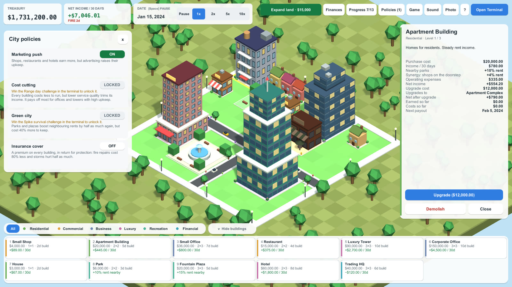

**Trading HQ.** The one landmark: its level (and look) follows your closed-trade record, not money, and it can fall if your record does.

---

## Missions, challenges and progress

**Progress** (top bar) shows the **land** you can buy, every **mission** with a progress bar (first trade, make a profit, fund the city, first building, first rent, own N buildings, reach a treasury or income target...) and the **achievements** you have earned. Missions unlock buildings and districts. The next goal is always shown in a card on the city screen.

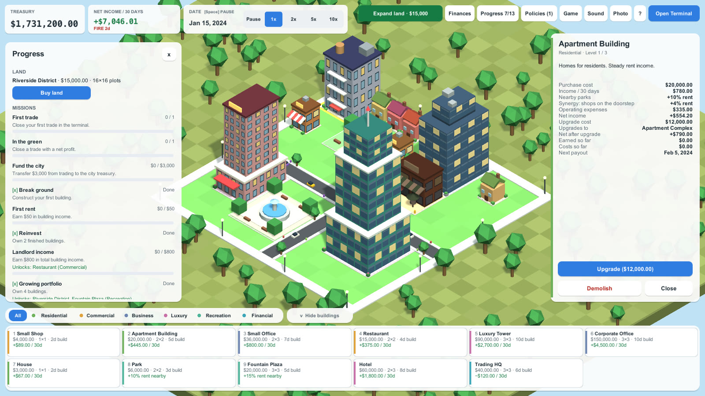

**Trading challenges** (the button in the terminal): practice runs on made-up markets with a fresh $10,000 that never touch your real account or city. *Catch the trend*, *Range day*, *Spike survival* and *Disciplined trader*, each with rules (a profit target, a maximum drawdown, a stop-loss on every trade, a trade limit...). Win them for **stars**; some also unlock a city policy.

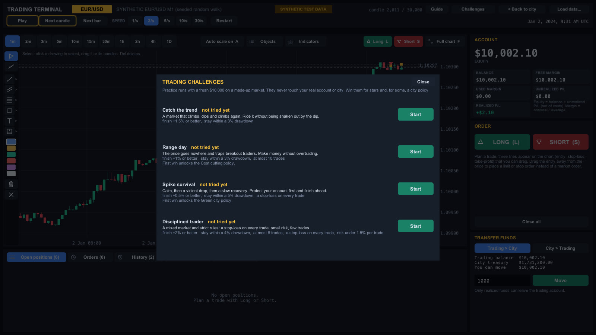

---

## Saves, settings and tools

The **Game** menu has **Save game**, **Load last save**, **Export to a file**, **Import from path**, **dated backups** (one per day, the newest 5), **Start a new game** (your previous save is kept as a backup) and **God mode (testing tools)**.

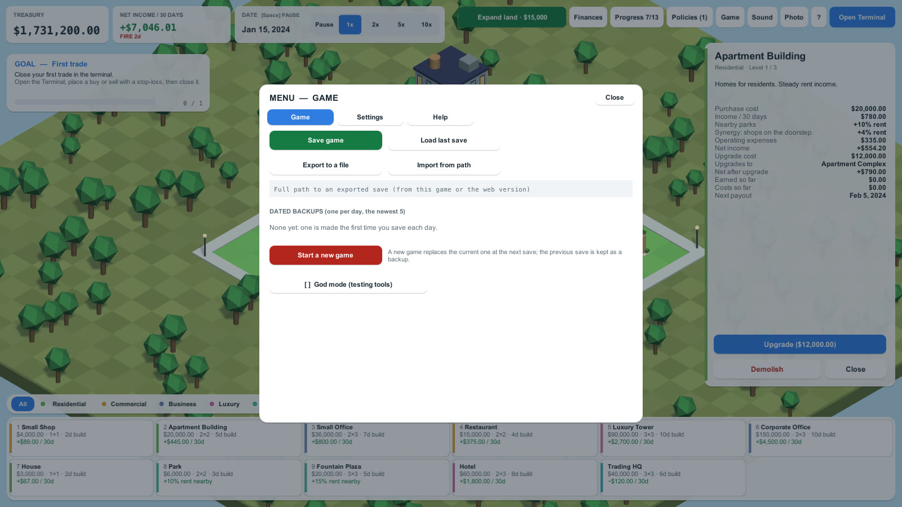

- **Autosave** every 30 seconds and when you quit. Saves live in `~/Library/Application Support/com.tradingempire.game/saves`, exports in the `exports` folder next to it.
- **Same format as the web game** (version 4): export from either game, import in the other. Your drawings, indicators, journal, loaded data and challenge results travel with it.
- **Settings:** interface size, colour-blind candles (blue and orange), sound on/off. The game is all synthesised sound (trades, building, rent, missions, events and a city hum that follows its size and mood).
- **God mode** (for testing): add $10k, $100k or $1M to the city treasury or the trading account, skip 1 to 90 days, unlock everything. Money goes through the real ledgers so saves stay valid, but progress made this way is not earned.

---

## All the keys

**City:** `W A S D` or arrows pan, right-drag pans, mouse wheel zooms, `1`-`9` pick a building, `R` rotate, `Esc` or right click cancel, `Space` pause or resume the city clock.

**Terminal:** `Space` play/pause, `Right arrow` next candle, `Shift + Right` next bar, `L` / `S` plan a long / short, `Enter` place the plan, `Esc` cancel the plan, then the tool, then full chart, then back to the city.

**Chart:** `V` cursor, `M` measure, `T` trend line, `H` horizontal line, `R` rectangle, `G` Fibonacci, `X` text note, `A` auto scale, `F` full chart, `Delete` remove the drawing, `End` newest candle, mouse wheel zoom, `Shift`/`Ctrl` + wheel scale prices, drag to scroll.

---

## Run it, build it, test it

**Play in the editor:** open the project in Unity `6000.2.13f1`, open `Assets/Scenes/Terminal.unity` and press **Play**. The game builds itself.

**Build the Mac app** (a universal Apple silicon and Intel `Trading Empire.app`, about 100 MB; not signed with a developer certificate, so right-click and choose Open the first time):
```bash
Unity -batchmode -quit -projectPath . -executeMethod TradingEmpire.EditorTools.BuildMac.BuildCli -buildOutput Builds/macOS
```

**Pictures and trailer:** the screenshots in `docs/screenshots` are rendered by the game itself. The trailer is recorded from the real game: `"Trading Empire.app/Contents/MacOS/Trading Empire" -te-trailer frames` plays a scripted tour and writes every frame, then ffmpeg joins them with `docs/trailer/make_music.py` music.
```bash
Unity -batchmode -projectPath . -executeMethod TradingEmpire.EditorTools.TerminalScreenshot.CaptureCli -shot out
```

**Tests (no Unity needed for the rules):**
```bash
cd Tests/Core.Tests && dotnet test      # 217 tests of the game rules
```
**Window > General > Test Runner > PlayMode** (or `Unity -batchmode -runTests -testPlatform PlayMode`) runs the real game loop and clicks the real buttons (21 tests), including random clicks with junk typed into text fields and a random chart-work test; any console error fails a test.

---

## For developers

Rules carried over from the web game:
- Money is integer cents (`Money`), never floats; rounding is half-even, once.
- Domain logic (finance, trading, city, save) is pure C# with no UI or engine references.
- The UI never changes balances directly; it goes through services.
- The trading account and the city treasury are separate; only the transfer service moves money between them.
- No lookahead: only revealed candles are ever exposed (`MarketReplay`).

Layout:
- `Assets/Scripts/Core/` pure C# game logic (`noEngineReferences`), compiled by Unity and by plain `dotnet`: `Common`, `Trading` (replay, engine, orders, drafts, indicators, journal), `City` (grid, economy, events, policies, mood, transfers), `Config`, `Progression` (missions, challenges, achievements, tutorial), `Save` (a small JSON library, the web-compatible v4 codec, backups), `Drawings`, `Audio`.
- `Assets/Scripts/Terminal/` the UI, built in code (no prefabs, no art files): the 3D isometric city, the HUD and panels, the chart mesh and tools, the terminal and the journal. `GameApp` builds everything when you press Play.
- `Assets/Editor/` editor tools: render screens to PNG from the command line, build the Mac app.
- `Tests/Core` a `netstandard2.1` project that compiles the same `Assets/Scripts/Core` files; `Tests/Core.Tests` xUnit tests ported from the web game so the expected numbers match.
- `docs/` pictures, the sample data file and the trailer.
